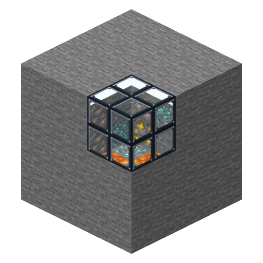
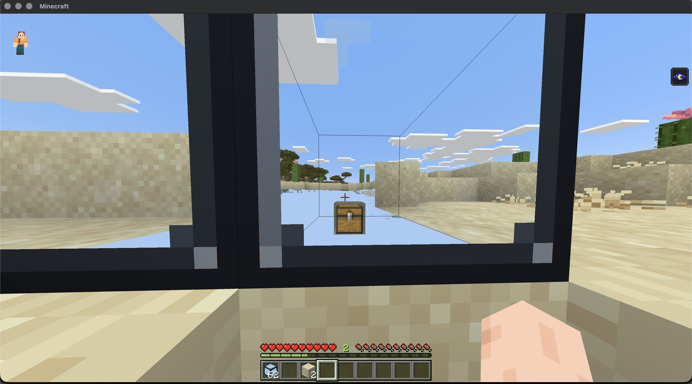

# CaveBlock 🕳️

**See through the ground.** Place a Cave Block in a wall or a floor and look
into it: you see straight through the rock behind it, right into the caves.





## Features

- 🕳️ A real custom block — no shader, no client mod
- ⛏️ Look into it to find caves, ores and hidden rooms behind the rock
- 🧱 Breaks, drops and places like any other block
- 🎨 Shows up in the creative inventory (Construction tab)
- ⚙️ Zero setup — the plugin turns on the client feature it needs by itself
- 📦 The texture pack installs itself — players download it automatically

## Install

1. Put `CaveBlock-x.y.z.jar` in your `plugins/` folder.
2. Restart the server. Done!

Get the block from the creative inventory, or with
`/give <player> caveblock:cave_block`.

## How it works

The Cave Block uses the client's voxel shapes: it tells the client it fills the
whole cell, so the blocks touching it hide the faces against it, while it draws
only its frame. Stone never draws the faces between two stones, so looking
into the Cave Block shows straight through the rock until the next open space.

The plugin adds the `voxel_shapes` experiment to what the server sends players
at login (no need to edit `pnx.yml`).

## Requirements

PowerNukkitX 3.0.6+ · Java 21 · Bedrock 1.26.x

## For developers

```bash
./gradlew build
```

MIT license — do whatever you want with it.
